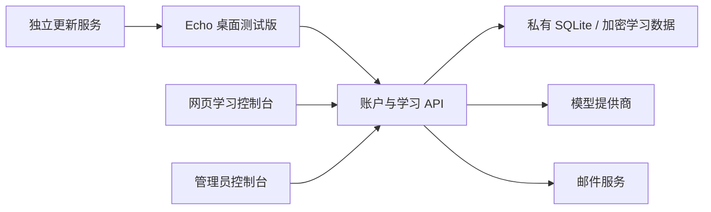

# Echo 产品需求与技术交接说明

文档版本：1.0 · 更新日期：2026-11-15 · 状态：内测交接稿

面向产品评审、设计、客户端开发、后端开发与测试人员。本文描述当前实际实现，不包含账号口令、服务器私钥或服务商令牌。文档版本不是客户端发布版本。

## 1. 产品定位与当前状态

Echo 是面向网课学习的 AI 学习辅助工具。桌面端负责听课与课堂交互，网页端承接账户、学习分析、复习与练习；两端通过账户 API 连接学习档案和复习进度。

核心闭环：课堂学习 → 识别知识点与薄弱点 → 保存学习档案 → 同步到云端 → 网页复习或答题 → 将复习结果同步回桌面端。

### 1.1 要解决的问题

- 学生在课堂中遇到理解断点，需要快速定位并补上关键步骤。
- 学习记录散落在单台设备，课后难以形成可持续的复习计划。
- 单纯展示知识点不等于掌握，需要回忆、自评、练习和后续复习安排。
- 账户服务需要可管理的邀请、权限、额度、邮件回执和操作记录。

### 1.2 发布状态

| 范围 | 当前状态 | 评审时需要知道的边界 |
| --- | --- | --- |
| 官网与网页控制台 | 已部署 | 用户中心与管理员后台采用侧栏分区 |
| 桌面账户与同步功能 | 本机测试源码 | 通过项目根目录 Echo-Test.cmd 启动，尚未发布新安装包 |
| Windows 公开下载 | 已发布的 2.4.0 | 仍为原有版本，不包含本次新增的完整账户同步体验 |
| macOS | 测试源码 | Swift 原生源码，要求 macOS 14+，需 Xcode 构建；无公开 DMG |
| Linux / 手机端 | 尚未发布 | 手机端是后续方向，不能视为已具备的产品 |

### 1.3 本阶段范围

已实现账户登录、可跳过的个人 API 模式、自动同步、学习分析、免费自评、网页 AI 单选练习、错题与解析、设备管理及管理员控制台。桌面端保留原皮肤，主要按钮略微缩小。

本阶段不做付费充值、提现、订阅、班级管理或教师评价。网页不承担实时课堂录音与听课；同步也不是完整课程文件的云盘备份。

<!-- PAGE -->

## 2. 用户角色与主要交互

### 2.1 角色

| 角色 | 可以做什么 | 不具备的权限 |
| --- | --- | --- |
| 访客 / 跳过登录的桌面用户 | 查看官网与下载页；桌面端使用自己的模型 API 和本地功能 | 不能使用账户 AI、云端同步或读取云端学习数据 |
| 注册用户 | 查看自己的档案、分析、复习、练习、学习点及登录会话 | 不能读取他人档案、修改余额或访问管理接口 |
| 管理员 | 管理用户、邀请与兑换码、AI 权限、学习点、邮件和服务统计 | 管理接口不提供其他用户学习正文的直接浏览入口 |

### 2.2 用户中心导航

| 分区 | 主要任务 |
| --- | --- |
| 空间概览 | 今日目标、待复习量、知识点数量、近七天网页复习节奏、同步状态 |
| 学习分析 | 知识状态与学科分布，按知识点、学科和掌握状态筛选 |
| 复习计划 | 到期、待加强及全部知识点；先回忆，再展开线索并自评 |
| 在线练习 | 选择知识点出题，提交答案，查看解析、练习记录和错题 |
| 云端数据 | 设备快照、同步信息、手动导入与档案备份 |
| 账户与用量 | 学习点余额、兑换码、AI 请求与余额流水 |
| 账户设置 | 显示名称、每日目标、账户同步开关、密码及登录会话 |

### 2.3 三条主流程

**首次使用**：打开测试版 → 登录或邀请码注册 → 了解默认同步范围 → 进入桌面。注册必须设置并确认密码；登录可选密码或邮箱验证码。用户也可明确选择“暂时跳过”，随后使用自己的模型 API。

**课后复习**：桌面保存记录 → 自动同步 → 网页显示真实分析与到期复习 → 用户自评或答题 → 后端更新复习安排 → 桌面下次同步合并较新的复习结果。

**账户与支持**：用户发现验证码未到或额度异常 → 管理员按邮箱查询验证状态、回执或账户流水 → 根据实际状态处理，不以“已提交”代替“已进入收件箱”。

### 2.4 交互要求

每个侧栏入口只呈现当前任务，不把所有表单堆在一个页面。必须提供加载、空数据、成功、失败与重试提示。图表不填充虚构数据。桌面登录框使用与当前主题一致的滚动背景，在较矮屏幕上仍可到达底部操作。

<!-- PAGE -->

## 3. 功能需求与验收条件

以下状态表示当前代码与已完成验收，不代表已经公开发布对应的桌面安装包。

| 编号 | 功能与验收条件 | 当前状态 |
| --- | --- | --- |
| ACC-01 | 只有完成注册的账户可登录；邀请码、邮箱码和密码均由服务端验证 | 已实现 |
| ACC-02 | 注册密码为 12-128 位并二次确认；登录支持密码或验证码 | 已实现 |
| DESK-01 | 默认推荐登录；跳过后只使用个人 API，不启用账户 AI 和同步 | 本机测试 |
| SYNC-01 | 登录后默认同步；可暂停本机或整个账户，可手动立即同步 | 本机与后端已实现 |
| SYNC-02 | 设备独立递增版本；相同内容不重复产生版本；冲突不盲目覆盖 | 已验证 |
| SYNC-03 | 切换账户不会自动上传旧账户资料；请求固定使用发起时的会话 | 已验证 |
| LEARN-01 | 分析来自实际档案；同名知识点按学科保留；指标不冒充考试成绩 | 已实现 |
| REVIEW-01 | 自评免费；结果去重并安排下次复习；较新结果可回传桌面 | 已验证 |
| QUIZ-01 | AI 出题前预扣学习点；失败或题目格式不合格返还 | 已验证 |
| QUIZ-02 | 作答前不返回答案和解析；服务端判分；同一题不能换答案刷结果 | 已验证 |
| DATA-01 | 用户仅访问自己的档案；可手动上传、查看、下载、删除快照 | 已验证 |
| ADMIN-01 | 管理邀请与兑换码，记录使用者、时间、已使用或失效状态 | 已实现 |
| ADMIN-02 | 管理用户与 AI 权限、调整学习点、撤销会话，并保留审计 | 已实现 |
| MAIL-01 | 免费模式先验证收件邮箱；保存发信元数据与回执，不保存验证码明文 | 已验证 |
| UI-01 | 桌面保留原皮肤；登录滚动容器与主题一致，主要按钮略微缩小 | 已修正并检查 |

### 3.1 自评与练习的区分

免费自评记录用户自己的感受，不等于客观判分。“还是没懂”安排约 1 天后复习，“有点模糊”约 3 天后，连续“记得清楚”按 7 / 14 / 30 / 60 / 120 天阶梯推进。

AI 练习目前为四选一单选题。生成成功消耗服务端配置的学习点，当前默认为 1 点；提交答案不额外扣点。重复生成请求使用同一 UUID 时不重复扣点。出题与解析可能有误，必须提示结合教材核对。

### 3.2 余额的产品含义

当前余额仅表示内测学习点，不是可提现资金。注册邀请可赠送学习点，已有账户可使用兑换码，管理员可按原因调整并留流水。本阶段未开通充值、支付和退款到资金账户。

<!-- PAGE -->

## 4. 架构、数据范围与同步规则

### 4.1 系统分工



网站为 Node.js 静态资源服务，账户后端为 FastAPI，Nginx 提供 HTTPS 和反向代理。SQLite 保存账户与事务数据，学习快照、复习状态及题目参考答案采用服务端 AES-GCM 静态加密。更新服务独立运行，不接收学习资料。

### 4.2 数据范围

| 同步 / 保存 | 排除 |
| --- | --- |
| 个人学习资料、知识点与掌握指标、薄弱点、复习进度、学习偏好 | 模型密钥、会话令牌、录音、截图、原始课件、完整课堂原文、HTML 代码 |

同步使用 echo.learning-profile 2.0.0 白名单导出，服务端再次验证结构、体积与禁止字段。服务端静态加密不是端到端加密；服务器持有解密所需的秘密配置。

### 4.3 时序与冲突处理

- 桌面约每 15 秒检查文件变化；有变化时至少间隔 20 秒安排同步，稳定时约每 2 分钟拉取网页复习进度。网络失败不阻塞课堂，保留本地文件后续重试。
- 每个账户最多 5 台设备，每台保存最新快照和独立版本。请求需携带 base_revision，版本不符返回 409；客户端下一次先读状态再重试。
- 跨设备按知识点 ID 合并。课程数采用设备快照最大值，避免重叠记录相加；课程指标以最近同步快照为准，复习记录采用较新的复习时间。
- 本地资料首次关联当前账户。换账户时暂停上传，必须明确确认资料归属后重新关联；不会自动把旧资料传给新账户。
- 本机旧复习格式没有学科字段。跨学科同名知识点的复习保留在网页并提示，避免错误覆盖。完整课堂历史与原始资料不自动下载或恢复。

<!-- PAGE -->

## 5. API 交接摘要

原生客户端 API 基址：https://api.echo.xhbtroy.cn/v1。网页同源代理前缀为 /api/account/。身份来自受保护的 Cookie 或 Bearer 会话；写请求需要 X-Echo-CSRF: 1。客户端不能指定自己的账户余额或服务商密钥。

### 5.1 主要接口

| 接口 | 用途 |
| --- | --- |
| POST /auth/register、POST /auth/login、POST /auth/code | 注册、登录与验证码 |
| GET /me/workspace | 合并后的学习分析、复习、设备和练习记录 |
| GET /me/sync、POST /me/sync | 拉取同步状态与提交设备快照 |
| POST /me/review | 提交自评，包含知识点 ID、结果和 UUID 请求号 |
| POST /me/practice | 按知识点生成题目，包含 UUID 请求号 |
| GET /me/practice/{id} | 获取本人题目；提交前隐藏答案与解析 |
| POST /me/practice/{id}/answer | 提交选项下标，由服务端判分 |
| POST /me/preferences、GET /me/sessions | 账户偏好与有效会话 |
| POST /me/sessions/revoke-others | 保留当前登录，退出其他会话 |
| GET /admin/workspace | 管理员聚合运行统计，不包含学习正文 |

手动档案接口为 GET / POST /me/profiles、GET / DELETE /me/profiles/{id} 与 GET /me/profiles/{id}/download；设备快照删除接口为 DELETE /me/devices/{id}。现有管理员用户、代码、邮件和审计接口继续保留。

### 5.2 同步请求示意

```json
{
  "protocol": "echo.sync/1",
  "account_id": "与当前会话一致的账户ID",
  "device_id": "设备UUID",
  "device_name": "Echo Desktop",
  "base_revision": 0,
  "consent": true,
  "profile": { "format": "echo.learning-profile", "其余字段": "遵循2.0.0 Schema" }
}
```

以上是字段示意，不是可直接发送的完整档案。完整 Schema 见 docs/learning-profile.schema.json，虚构示例见 docs/examples/learning-profile.json。不得用真实用户资料作为共享测试样本。

### 5.3 账户 AI 协议

桌面账户 AI 使用 POST /echo/inference 与 echo.inference/1，包含 account_id、UUID request_id、任务类型和消息上下文。服务端核对身份、权限、额度和请求去重，再调用模型。通用 /chat/completions 代理已经关闭。401 表示需要登录，403 表示权限或账户不匹配，402 表示额度不足，409 表示冲突或已处理，429 表示限流。

<!-- PAGE -->

## 6. 安全、容量与运维要求

### 6.1 已有防护

- 全站 HTTPS；Nginx 与应用层均限制频率和请求体积。会话、用户数据归属和管理员权限由各接口独立检查。
- 网页使用安全 Cookie、同源策略和 CSRF 请求头；原生会话保存在系统凭据库。密码保存 Argon2 哈希，验证码保存不可逆摘要，不记录验证码明文。
- 账户模型密钥、邮件凭证与认证秘密仅在服务器私有配置内；不进入网页资源、桌面安装包、镜像或交接文档。
- AI 请求先预扣、成功确认、失败返还；请求号去重防止重试重复扣点。用户不能通过修改请求声明来伪造学习点。
- 服务容器只监听本机代理地址，使用低权限用户、只读文件系统、资源限制和日志轮转。

这些措施降低风险，不构成“绝不会被攻击”的保证。后续仍需要依赖更新、监控、备份恢复演练及安全测试。

### 6.2 当前容量边界

| 项目 | 当前限制 |
| --- | --- |
| 单份学习档案 / 单设备快照 | 最大 1 MiB |
| 手动档案 | 每账户最多 10 份，合计 10 MiB |
| 自动同步设备 | 每账户最多 5 台 |
| 全站学习快照与手动档案 | 原始大小合计最大 64 MiB，不等同整个数据库大小 |
| 账户 AI 并发 | 全站最多 8 个，同一用户最多 2 个处理中请求 |
| 学习分析整理 | 同时最多整理 1 份，避免小内存服务器突发占用 |
| Docker 内存上限 | 网站 96 MiB、账户服务 192 MiB、更新服务 64 MiB |

### 6.3 邮件与备份

免费邮件模式要求收件人先完成 Cloudflare 邮箱验证。后台分别显示收件服务器接受、服务商排队、提交失败或状态未知；服务器接受不等于已进入收件箱。投递超时时，晚到的验证码在有效期内仍可使用。

验证码有效期为 5 分钟，新申请替换旧码。管理员发信记录保留元数据与回执，不保存邮件正文；记录保留 30 天。每日备份保留最多 7 天，在线删除不会立即抹除既有日常备份。题目和网页复习事件按当前维护规则保留 90 天，界面展示最近 100 题。

运行交接时，凭证应通过独立安全渠道交付。不得把已有私钥、GitHub 或 Cloudflare 令牌、管理员密码复制进 PRD、截图、聊天转发或仓库。

<!-- PAGE -->

## 7. 测试、发布与待确认事项

### 7.1 已完成的验证

| 范围 | 证据 |
| --- | --- |
| 账户与后端 | 31 项隔离测试通过，覆盖归属、版本、暂停、去重、退款和判分 |
| 桌面原有功能 | 28 项完整回归通过，包括课堂、复习、更新和 6 套主题 |
| 桌面同步 | 8 项隔离测试通过，包括换账户、断网、较新记录及跨学科同名保护 |
| 登录框显示修复 | 6 套主题的背景、文字色、小屏滚动检查通过，并检查 Windows 原生渲染 |
| 公网真实链路 | 临时虚构账户完成 HTTPS 同步、复习回传、真实出题、重放去重和判分 |
| 网页交互 | 浏览器验证侧栏、知识分析、题目选项、提交与解析；虚构验收数据已清理 |

测试入口包括 scripts/accept_check.py、scripts/account_client_check.py、scripts/account_visual_check.py、scripts/cloud_sync_check.py 和 Echo Website/account-server/test_accounts.py。外部邮件收件箱是否收信需由收件人确认，服务端回执不能替代该确认。

### 7.2 当前已知边界

- 新桌面账户与同步代码只在本机测试，公开 Windows 2.4.0 不具备本次新增的完整同步体验。网页已上线不代表安装包已经更新。
- 跨设备同步是学习档案与复习进度同步，不是完整课堂文件的无损备份或恢复。
- 旧本机复习格式不能准确区分跨学科同名条目，这些复习保持在网页，等待后续数据模型升级。
- 学习指标与自评不等同成绩；AI 出题与解析可能有误。没有上线付款或对外承诺收费服务。
- 当前为小规模内测架构；大规模使用、负载压测与完整备份恢复演练仍需另行验收。

### 7.3 对外发布前的检查清单

1. 用实际 Windows 环境复核首次登录、邀请码注册、邮件验证、跳过与个人 API 设置，检查高 DPI 和短屏。
2. 用两个测试账户、两台测试设备验证资料归属、版本冲突、暂停 / 恢复与复习合并。
3. 验证备份恢复及认证秘密的保管方式，测试限流和容量满时的用户提示。
4. 完成新安装包构建、签名、升级与回滚验收后，再更新官网版本信息和发布下载。
5. 对外使用前补齐隐私说明、数据删除流程、联系方式和邮件服务方案。

### 7.4 下一阶段建议

优先升级带学科身份的本地复习模型，并补充两台真实设备的长期同步验收。之后再评估手机端、更多题型、个人复习笔记和更完善的监控。支付与商业化应独立立项，不与本次同步改造混在一起。

参考代码入口：echo/backend/account.py、echo/backend/cloud_sync.py、echo/widgets/account_login.py、Echo Website/account-server/cloud.py、Echo Website/public/console.js。更详细的工程说明见 docs/cloud-workspace.md。
